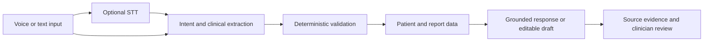

# Architecture (one page)



```
 Clinician speaks / types
        |
        v
 [ Audio ] --POST /transcribe--> [ STT adapter: Whisper API | mock ]  --> transcript (clinician can edit)
        |                                         (stt.py)                     |
        +------------------------- typed text -------------------------------+
                                           |
                                           v
                          POST /assistant/message {text, session_id}
                                           |
              +----------------------------v-----------------------------+
              | 1. INPUT VALIDATION (validators.py): type, length, control chars |
              +----------------------------+-----------------------------+
                                           v
              +----------------------------+-----------------------------+
              | 2. INTERPRET (interpreter.py)                              |
              |    LLM -> {intent, patient_name, report_type, pronoun}     |
              |    Pydantic parse + validate_interpretation()              |
              |    any failure -> deterministic rule-based fallback        |
              +----------------------------+-----------------------------+
                                           v   (LLM output is a proposal, never a fact)
              +----------------------------+-----------------------------+
              | 3. ROUTE + BUSINESS RULES (assistant.py)  <-- session.py   |
              |    open_report      -> retrieval.py tools                  |
              |    followup_summary -> conversation.py                     |
              |    ask_question     -> report_chatbot.py                   |
              |    dictate_finding  -> clinical_draft.py                   |
              +--------+-----------+------------+-----------+------------+
                       v           v            v           v
              find_patients   get_latest_   resolve      extract findings
              (exact/token/   report /      context      (rules; LLM optional)
              prefix/fuzzy)   report_by_id  (+gender     -> GROUNDING VALIDATOR
              ambiguity rules               check)       -> render draft text
                       \           |            |           /
                        v          v            v          v
              +----------------------------------------------------------+
              | 4. RESPONSE: status, answer/draft, evidence (report id,   |
              |    type, date, finding), sources, interpretation, latency |
              +----------------------------------------------------------+
```

## Voice / STT
The microphone captures audio and shows browser speech recognition as a live preview. After a pause, the UI submits
the audio to `/transcribe` with `task=translate`; Whisper's OpenAI-compatible `/audio/translations` endpoint returns
English text for supported source languages. On the Voice Assistant page, that transcript is submitted as a command;
on Clinical Draft, it creates a draft. The transcript and result remain editable. The browser reads the assistant's
concise response aloud with speech synthesis while the UI shows source reports and evidence. Translation requires
`STT_PROVIDER=api` and a valid `LLM_API_KEY`; offline `mock` mode cannot translate audio. If translation is
unavailable on Clinical Draft, the original words are preserved for review without interpreting them. Browser speech
recognition may use the browser's online speech service, but it is only a preview. The API also supports
`task=transcribe` with an explicit language for uploaded audio. The assistant consumes text, so the STT provider can
change independently of report retrieval and draft generation.

Voice Assistant uses English browser speech recognition and keeps the microphone session open across turns: silence finalizes and submits a turn, while recognition remains active during speech playback so a new spoken instruction interrupts the reply. Assistant-echoed speech is filtered against the current reply. The user can end the session with a spoken stop phrase or the microphone button. English browser transcripts can be used without the translation
provider; non-English turns require configured STT translation outside the English-only live preview.

## LLM layer (optional, untrusted)
Two narrow jobs, both returning JSON that is validated before use: (1) intent/entity extraction, (2) dictation
finding extraction. The model has no access to the database and cannot call business operations directly; it proposes,
code disposes. This is equivalent to tool calling with a deterministic executor: the "tools" are `find_patients`,
`open_patient_report`, `get_report_by_id` and `create_clinical_draft`, selected by the validated intent.

## Tool / API layer (deterministic)
`retrieval.py` holds the business rules: several matches -> `ambiguous`; typo/prefix -> `ambiguous` (confirm);
requested type absent -> `report_not_found` (lists what exists); unsupported type -> `invalid_report_type`;
"latest" = newest `date` of the requested type.

## Report generation
Findings are built per clause with `source_phrase`, FDI tooth number only when stated, and certainty
(`stated` / `uncertain` / `negated`). The readable draft separates clinical observations, site, certainty, and
clinician-review instructions. Unrecognized wording is retained verbatim as unclassified, with no invented site
or finding. `requires_clinician_review` is always true. LLM findings that fail the grounding check are dropped
and reported; sentences the LLM missed are recovered by the rules. The UI presents each finding, anatomical site,
certainty, and source evidence in its own editable section, and exports the reviewed draft as PDF or structured JSON.

## Conversation memory
`session.py` keeps `{patient, report_id, pending candidates}` per `session_id` (TTL-expiring). Pronouns resolve only
from this server-side state; a gender mismatch or an unresolved ambiguity produces a question instead of an answer.
